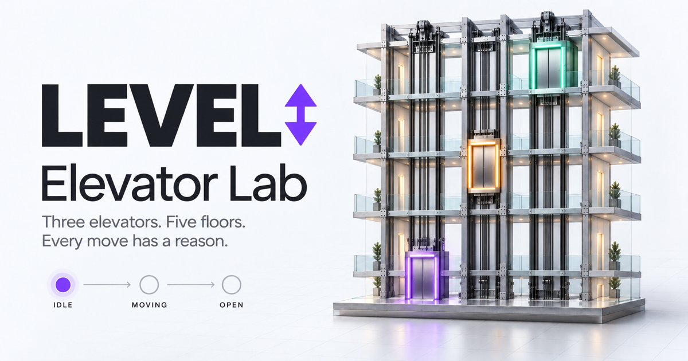
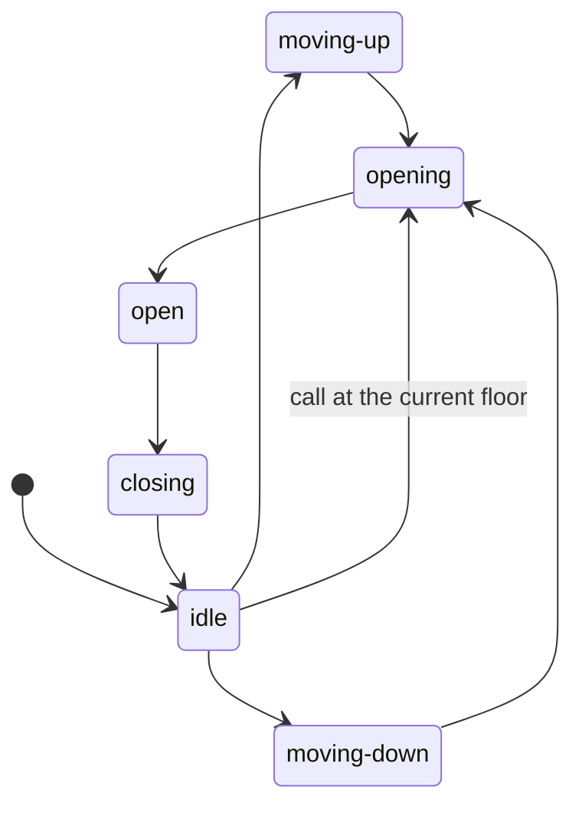

# Elevator Lab



An interactive lab with three elevators, five floors, and a state machine you can watch in action.
Call an elevator, choose a destination inside a car, and follow its route, doors,
request queue, and state transitions.

## Getting started

Requires Node.js 24 and pnpm **12.14.0** (pinned in `package.json`).

```bash
corepack enable
corepack prepare pnpm@12.14.0 --activate
pnpm install --frozen-lockfile
pnpm start
```

The app runs at [localhost:4200](http://localhost:4200).

You can also check the production SSR build separately:

```bash
pnpm build
pnpm serve:ssr:elevator-demo
```

The server listens on port 4000 (or `PORT`). The local hosts `localhost` and `127.0.0.1`
and the production host `elevatorlab.antonsizov.cloud` are allowed in `angular.json`.

## SEO and social previews

The canonical URL is [elevatorlab.antonsizov.cloud](https://elevatorlab.antonsizov.cloud/).
The homepage is prerendered, so its content and metadata are available without JavaScript.
`src/index.html` defines the title, description, canonical URL, indexing directives,
Open Graph and Twitter large-image cards, and `WebApplication` JSON-LD in American English.
`public/robots.txt` points crawlers to the single-page `public/sitemap.xml`.

The social preview is `public/og-image.png`, a 1200 × 630 PNG also embedded above.
It was created with the built-in image generation tool; the prompts are saved in
[`docs/og-image-prompt.txt`](docs/og-image-prompt.txt).
The Express server caches the image, robots file, and sitemap for one hour so updates
can be revalidated, while other static assets retain their existing cache policy.

Run `pnpm build && pnpm check:seo` to verify the generated HTML, crawl files, image, and
README reference. This check also runs in CI through `pnpm validate`.
If the production domain changes, update the URLs in `src/index.html`, both crawl files,
the allowed host in `angular.json`, and the expected origin in `scripts/check-seo.mjs`.

## Things to try

- The lobby on floor 1 has an up button, floor 5 has a down button, and the other floors have both.
- Select car A, B, or C and choose a destination on its control panel.
- Place several calls: the dispatcher assigns them to cars based on their routes.
- Run the demo scenario, pause the simulation, or increase the speed to 2× / 4×.
- Watch the selected car's current state and the event log. Reset restores the initial state
  and clears requests, statistics, and the scenario.

## Project structure

```text
src/app/
  domain/elevator/      Pure model, elevator classes, FSM, and dispatch strategy
  application/          Angular facade, user commands, scenario, and clock adapter
  features/simulator/   Simulator screen and building, car, FSM, and event log components
  shared/               Reusable components with no elevator-specific knowledge (as needed)
  app.component.*       Application composition root
scripts/
  check-architecture.mjs       TypeScript AST checks for dependency direction
  check-architecture.test.mjs  Independent file fixtures for the checker itself
  check-seo.mjs                Production HTML, crawl files, and social image checks
```

This is a small layered architecture with one owner of the simulation state. Components
send commands to `SimulationService` and read readonly signals. The facade manages an
`ElevatorSimulation` instance, publishes snapshots, and runs the scenario. Movement and
assignment rules stay in the domain. Components do not create their own timers or mutate
domain objects directly.

| Layer                        | Allowed internal dependencies                       | Alias            |
| ---------------------------- | --------------------------------------------------- | ---------------- |
| `domain`                     | `domain` only                                       | `@domain/*`      |
| `application`                | `application`, `domain`                             | `@application/*` |
| `shared`                     | `shared` only                                       | `@shared/*`      |
| `features`                   | The same feature, `application`, `domain`, `shared` | `@features/*`    |
| Application root / bootstrap | Composes all layers                                 | —                |

Use aliases from `tsconfig.json` across layers and relative imports within a layer.
A feature cannot import another feature. The `domain` layer has no dependencies on Angular,
third-party packages, the DOM, or browser timers. The `shared` layer can use Angular, but
cannot depend on application services or domain entities. Before adding a new top-level
folder inside `app`, add it to the architecture rules and their tests.

The checker resolves paths with the actual TypeScript resolver and the current
`tsconfig.json`, then checks the target file's layer. It covers regular and type-only
imports, re-exports, `import()`, inline import types, `require()`, and import-equals.
Unresolved local imports and computed import paths are errors. Unit tests are excluded
from dependency checks so they can use Angular test helpers.

## State machine

`ElevatorStateMachine` stores the current state and validates transitions.
`ElevatorCar` manages position, doors, and the stop queue.
`ElevatorSimulation` owns the three cars, requests, events, and statistics.



The FSM prevents state transitions between floors and checks the door position. A car
can start moving only with its doors closed; it selects the next stop after the door
cycle completes. Travel takes 1800 ms per floor in simulation time. Opening and closing
take 600 ms each, and the doors stay open for 1400 ms. These settings live in `ELEVATOR_CONFIG`.

`DispatchStrategy` lets you replace the assignment algorithm without changing the state
machines. The current `NearestRouteDispatchStrategy` considers distance, direction,
already assigned stops, and door delays. It uses a heuristic to estimate route suitability
and waiting time rather than predicting an exact arrival time. Ties produce a stable result.
Up and down calls on the same floor remain separate requests.

## Time, SSR, and testability

The domain receives elapsed time through `tick(deltaMs)`. It does not read the system
clock or create timers: the same sequence of commands and time steps produces the same
result. It can be tested without a browser or Angular.

`BrowserSimulationClock` is a separate adapter provided through the `SIMULATION_CLOCK`
DI token. It starts `requestAnimationFrame` after browser rendering, does not access the
DOM during SSR, caps unusually long intervals, and pauses simulation time in hidden tabs.
The timing baseline resets when the tab becomes visible, when pause is toggled, and when
the speed changes. Listeners and RAF callbacks are cleaned up when the service is destroyed.
Tests replace the adapter with a manual clock. The demo scenario splits time steps at
command boundaries so event order does not depend on frame rate.

## Checks

```bash
pnpm lint                # Architecture + strict TypeScript
pnpm test:architecture   # Fixtures, including attempts to bypass layer boundaries
pnpm test --watch=false  # Domain and Angular application layer
pnpm build               # Production browser/server build and template checks
pnpm check:seo           # Check SEO artifacts after a production build
pnpm format:check        # Check formatting without changing files
pnpm format              # Apply Prettier
pnpm validate            # Complete CI validation sequence
```

Both `strict` and `strictTemplates` are enabled. The `validate` command checks formatting,
architecture, checker fixtures, unit tests, the production build, and SEO artifacts. It does not run a
separate TypeScript check because the build already checks TypeScript and Angular templates.
GitHub Actions installs dependencies with `--frozen-lockfile` and runs `validate`.

The local pre-commit hook checks formatting and layer boundaries. It is installed explicitly
and does not change Git settings during dependency installation:

```bash
pnpm hooks:install
```

Angular class and file names keep their suffixes: `ExampleComponent`,
`example.component.ts`, `SimulationService`, and `simulation.service.ts`.
Generator settings are in `angular.json`.

## Model limitations

This is an educational dispatch simulation, not software for controlling real elevators.
Requests represent calls rather than passengers: the model does not include capacity,
weight, boarding, emergency modes, or physical acceleration. Destinations inside cars
are set by the user or the demo scenario. State is kept in memory and resets on reload.
